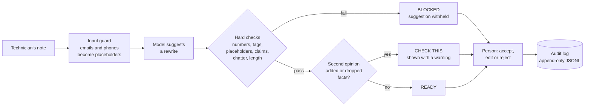

# LLM suggestions with guardrails and a human in the loop

[](https://github.com/devpatram/llm-guardrails-hitl/actions/workflows/ci.yml)


A maintenance technician types a quick shift note: `repl brg on cnvyr CV-3, still noisy, chk tmrw`. A customer will
read it. A language model can turn it into clean sentences, but in this setting a rewrite that changes a number,
drops an asset tag or adds "the issue is fully resolved" is worse than no rewrite at all.

This repo is the pattern I use for that: **the model suggests, deterministic checks and a second opinion filter, and
a person decides.** Nothing reaches the record without a human choosing accept, edit or reject, and every decision is
logged.

> All notes, tags and contact details in this repo are made up.

## How it works



| Layer | What it does | Why |
| --- | --- | --- |
| Input guard | Emails and phone numbers are replaced with `[EMAIL_1]`, `[PHONE_1]` before the model sees the note, then put back. Empty or very long notes stop here. | Contact details never leave for a model. |
| Hard checks (`hitl/rules.py`) | Every number, asset tag and placeholder must survive unchanged (`two` = `2`, `3.0` = `3`, `CV-3` = `CV3`). No new assurance phrases ("root cause", "fully resolved", "safe to run"). No model chatter ("Here is..."). Length within 0.6x to 2.5x. | Plain Python: fast, free, testable, same answer every time. A failure withholds the suggestion. |
| Second opinion | The provider lists facts the rewrite added or dropped. Anything listed marks the suggestion CHECK THIS. An unreadable reply counts as a reason to look, never as a pass. | Catches meaning changes that do not touch a number or tag. |
| Fail closed | A model error or timeout blocks; the original note stands. | An outage must never produce text nobody checked. |
| Human decision | Accept is offered only when the checks passed. An edit that breaks a check is allowed but recorded as an override. | The person is accountable for the final text, and the log shows what they saw. |
| Audit log | One JSON line per decision: status, findings, second opinion, decision, reviewer, final text and its hash. | You can answer "who approved this wording, and what were they shown?" |

## Evaluation

`eval/cases.jsonl` holds 40 labeled cases: 12 good rewrites (including number words, decimals, thousands separators
and tags with and without dashes) and 28 bad ones across ten failure types. `python eval/run_eval.py` writes
[`eval/report.md`](eval/report.md). With the offline second opinion:

| Bad suggestions (28) | Cases |
| --- | --- |
| Blocked by the hard checks | 23 (82%) |
| Flagged by the second opinion | 4 (14%) |
| Reached the reviewer looking clean | 1 (4%) |

| Good suggestions (12) | Cases |
| --- | --- |
| Passed clean | 5 |
| Flagged by the second opinion (a false alarm the reviewer clears) | 7 |
| Blocked by the hard checks | 0 |

What this shows:

- **The hard checks caught every bad case in the nine categories they target**, with no false blocks on good
  rewrites.
- **Meaning changes are where rules stop.** "Still noisy" rewritten as "the noise has stopped" changes no number or
  tag. The second opinion flagged 4 of 5. The one that got through dropped a negation: "did not repl seal" became
  "Replaced the seal". A negation check is the next hard rule to add, with new cases written for it.
- **The offline second opinion is crude** (it compares content words), so it raises false alarms on 7 of 12 good
  rewrites. That costs the reviewer a glance, not a wrong record. `--provider gemini` swaps in Gemini for the second
  opinion; I have not published numbers for it here.

40 cases is a small set written alongside the checks. Treat it as a regression suite, not a benchmark.

## Run it

```bash
pip install -r requirements-dev.txt
pytest -q
python eval/run_eval.py

python -m hitl suggest "repl brg on cnvyr CV-3, still noisy, chk tmrw"
python -m hitl review data/notes.jsonl --reviewer "J. Doe" --audit audit.jsonl
```

The review loop shows each note, its status and the reasons, then asks accept, edit or reject:

```
--- note N01 [READY]
Original:   repl brg on cnvyr CV-3, still noisy, chk tmrw
Suggestion: Replaced bearing on conveyor CV-3, still noisy, check tomorrow.
[a]ccept / [e]dit / [r]eject / [q]uit:
```

### With Gemini

```bash
cp .env.example .env    # your Google Cloud project, or a Gemini API key
set -a; . ./.env; set +a
python -m hitl --provider gemini suggest "repl brg on cnvyr CV-3, still noisy, chk tmrw"
python eval/run_eval.py --provider gemini
```

The Gemini provider calls with temperature 0, puts the note between `<<<` and `>>>` and tells the model the note is
data, not instructions (`data/notes.jsonl` includes a note that tries to give the model an instruction). The hard
checks do not trust the model either way.

## Layout

```
hitl/
  redact.py      input guard: contact details to placeholders and back
  rules.py       the hard checks
  providers.py   FakeProvider (offline) and GeminiProvider behind one interface
  pipeline.py    suggest -> check -> second opinion -> decide -> audit
  __main__.py    command line: suggest, review
eval/            labeled cases, the scorer and its report
data/notes.jsonl sample notes for the review loop
tests/           25 tests: every check, redaction, fail-closed, decisions and overrides, the CLI, the eval
```

## License

MIT. See [LICENSE](LICENSE).
